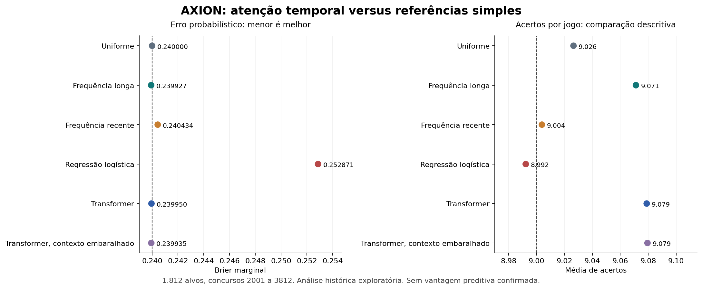

# AXION: teste de previsão temporal inspirado nas LLMs

Autor do projeto: Jacson Cruz do Nascimento. Rodada: 24/10/2026.

## Resultado principal

O Transformer pequeno não demonstrou melhora estatisticamente suficiente na métrica primária, Brier marginal, frente ao uniforme. A frequência longa apresentou erro um pouco menor que o Transformer. Nenhum dos quatro concorrentes passou pelo ajuste de Holm. A ordem temporal do contexto não demonstrou contribuição adicional na análise secundária.

A hipótese recebeu um teste operacional, com previsões efetivamente calculadas. Este resultado se refere à arquitetura e ao protocolo fixados nesta rodada; não prova impossibilidade universal de previsão nem autoriza promessa de vantagem.

## Pergunta e desenho

Pergunta: a atenção sobre concursos passados extrai informação útil ao próximo conjunto de dezenas, além de referências simples?

Foram usados os 3.812 concursos do snapshot do projeto, com avaliação nos concursos 2001 a 3812, totalizando **1.812 previsões por modelo** e sete blocos de até 300 concursos. O histórico inteiro já esteve acessível ao projeto. Portanto, esta é uma **avaliação retrospectiva exploratória**, mesmo com separação cronológica correta; não é um novo teste prospectivo.

Cada modelo usa somente resultados anteriores ao seu alvo. O ajuste é congelado no começo do bloco externo. Frequências e contextos dos alvos seguintes podem usar resultados anteriores daquele mesmo bloco, que já seriam conhecidos no momento correspondente. O Transformer usa as últimas 256 observações do treino exclusivamente para parada antecipada, e não para atualização de seus pesos. A regressão logística usa o treino completo do bloco; essa diferença de aproveitamento dos dados é uma limitação da comparação.

## Modelos fixados antes de calcular os resultados desta rodada

- Uniforme: probabilidade marginal 0,6 para cada dezena.
- Frequência longa: todo o passado, com prior uniforme equivalente a 100 concursos.
- Frequência recente: últimos 250 concursos, com o mesmo prior.
- Regressão logística: C=0,01, atributos de frequência em 5/25/100/500 concursos e resultado imediatamente anterior, padronizados exclusivamente no treino.
- Transformer: contexto de 32 concursos, dimensão 16, duas cabeças, uma camada, feedforward 32, dropout 0,1 e **3577 parâmetros** por modelo. Ensemble com seeds 17, 43 e 97; AdamW, lr=0,001, weight decay=0,01, no máximo 30 épocas, paciência 5, lotes 128.
- Sensibilidade secundária: o mesmo Transformer recebe os concursos de cada contexto em ordem pseudoaleatória. Os rótulos e o período de teste não mudam. É um teste de dependência da ordem, não uma simulação completa da hipótese nula.

Não foi feita busca de novas arquiteturas depois de observar os resultados externos. As probabilidades foram ajustadas por intercepto logístico comum para somar 15, permanecendo entre zero e um. Essas margens não especificam, por si só, a probabilidade conjunta de uma combinação de 15 dezenas.

## Resultados

Quanto menores Brier e log-loss marginal, melhor. As colunas 11+ a 15 são contagens de concursos, sempre por jogo único. Não há carteira de múltiplas apostas nesta comparação.

| Modelo | Brier | Log-loss marginal | Acertos médios | 11+ | 12+ | 13+ | 14+ | 15 | p Holm, Brier |
|---|---:|---:|---:|---:|---:|---:|---:|---:|---:|
| Uniforme | 0.240000000 | 0.673011667 | 9.0265 | 190 | 34 | 1 | 0 | 0 | secundário/referência |
| Frequência longa | 0.239927114 | 0.672859161 | 9.0712 | 212 | 28 | 1 | 0 | 0 | 0.3104 |
| Frequência recente | 0.240433867 | 0.673919261 | 9.0039 | 183 | 32 | 0 | 0 | 0 | 1.0000 |
| Regressão logística | 0.252870882 | 0.702120784 | 8.9923 | 210 | 38 | 3 | 0 | 0 | 1.0000 |
| Transformer | 0.239949771 | 0.672906818 | 9.0789 | 215 | 38 | 2 | 0 | 0 | 0.3104 |
| Transformer, contexto embaralhado | 0.239935198 | 0.672876457 | 9.0795 | 203 | 44 | 5 | 1 | 0 | secundário/referência |

No uniforme, o top-15 é escolhido por desempate pseudoaleatório determinístico dependente apenas do concurso. Sua média amostral difere de 9 por flutuação; a esperança matemática permanece 9.

### Desfecho primário

O ganho é Brier do uniforme menos Brier do concorrente; positivo significa melhora. Para o Transformer: **0.000050229**, IC95% exploratório **[-0.000023359; 0.000118272]**, p unilateral 0.0776 e p ajustado Holm **0.3104**. O intervalo inclui zero.

Para frequência longa: ganho **0.000072886**, IC95% **[-0.000040740; 0.000180997]**, p Holm **0.3104**. O intervalo também inclui zero.

O bootstrap circular usa blocos de 25 concursos, 9.999 réplicas e distribuição centrada para a cauda unilateral; depende de aproximações de estabilidade temporal e não é um teste exato de estratégias adaptativas. Holm foi aplicado aos quatro testes primários. Os intervalos apresentados são marginais, não simultâneos, e não corrigem as explorações anteriores do projeto. Acertos e faixas de premiação são descritivos, não testes adicionais de confirmação.

### A ordem do contexto ajudou?

Diferença Brier embaralhado menos ordenado: **-0.000014572**, IC95% **[-0.000057911; 0.000026452]**. O valor pontual favorece ligeiramente o contexto embaralhado e o intervalo inclui zero. Não se demonstrou contribuição da ordem temporal. Isso é compatível com o modelo aproveitar principalmente informação marginal; não identifica definitivamente o mecanismo interno aprendido.

## Qualidade dos dados e proveniência

Original: `Jacson-Nascimento/Jacson-Nascimento`, commit `db2d1d49855b31748c9fd3012f9775bb349cc586`, arquivo `lotofacil_axion/data/lotofacil_history.csv`, blob `5602df7bbe92ce5fa48ea5d49514a8dc07ccdd41`.

A primeira execução foi interrompida antes de treinar, pois a validação detectou datas fora de ordem. Consulta direta à API oficial da CAIXA confirmou a correção do concurso 3490 de 18/08/2025 para **18/09/2025**. O original foi preservado; um novo CSV recebeu exclusivamente essa correção de data, sem alterar dezenas. A API oficial também informa 20/06/2026 para ambos os concursos 3715 e 3716; a mesma data diária foi mantida e a ordem causal é dada pelo número do concurso.

As dezenas conferidas para os concursos 1, 3435, 3490, 3715, 3716, 3779 e 3812 coincidem com a CAIXA. **Sete checagens pontuais não equivalem a reconciliação integral do histórico.** Os registros e as URLs oficiais estão em `../../data/official_spot_checks.json`.

SHA-256 do derivado usado: `a8e29a54957f0d22a3fd204bc3be2c3974407e7d54df24c3255a06d9a530d7b8`. Configuração, ambiente, hashes do código, épocas e hashes dos pesos estão em `manifest.json` e `fit_metadata.json`. O CSV comprimido contém todas as probabilidades e os jogos selecionados de cada modelo, não apenas os melhores casos.

## Auditoria do registro prospectivo anterior

O resumo consultado no repositório original informa zero concursos avaliados, embora existam manifests de previsões posteriores. O manifest 3780 tem commit datado de 10/09/2026 e a CAIXA informa o sorteio em 15/09/2026, compatível com antecedência documental; o manifest 3813 registra geração em 24/10/2026 às 19h40 de Brasília. Esses metadados não comprovam isoladamente a primeira publicação nem a antecedência ao horário do sorteio. Nenhum registro antigo foi reescrito e nenhuma avaliação histórica foi acrescentada retroativamente como prospectiva. Evidência recuperada em `../../data/prospective_audit.json`.

## Decisão e próximo requisito

**Nenhum modelo promovido a regra de apostas.** A configuração inspirada em LLMs foi implementada e testada, mas não apresentou evidência suficiente no desfecho primário. A frequência longa permanece uma referência de pesquisa simples, sem vantagem confirmada nesta avaliação.

Qualquer rodada futura deve preservar este resultado e registrar previamente uma hipótese específica, o orçamento de busca e o critério de parada. Para sustentar alegação de previsão, são necessários manifests completos publicados antes dos sorteios, reconciliação dos dados e avaliação de resultados realmente posteriores. Aumentar a rede ou repetir buscas no mesmo histórico até encontrar p pequeno não resolve essas pendências.
